# OpenPuck user guide

This guide shows how to use your Life Puck running OpenPuck. It covers every
screen and every setting. Not installed yet? Start with the
[install guide](install.md).

**Contents**

- [Turning it on and off](#turning-it-on-and-off)
- [Battery and charging](#battery-and-charging)
- [Counting with one player](#counting-with-one-player)
- [Counting with two players](#counting-with-two-players)
- [The menu](#the-menu)
- [The power button](#the-power-button)
- [The timer](#the-timer)
- [History](#history)
- [Settings](#settings)
- [What is saved](#what-is-saved)
- [Tips](#tips)

## Turning it on and off

- **On:** press the power button. The OpenPuck logo shows for a moment, then
  the counter appears.
- **Off:** press and hold the power button for 2 seconds. The screen says
  "Release to power off". Let go and the puck switches off.
- **Auto-off:** the puck also switches itself off when it has been left alone
  for a while. See [Auto-off](#auto-off).

A quick tap on the power button does not turn the puck off. It is used for
going back and for the timer (see [The power button](#the-power-button)).

## Battery and charging

Plug in a USB-C cable to charge.

- The battery icon shows how full the battery is. It turns **red** when the
  battery is low (10% or less).
- While the puck is **charging**, the icon turns **green**.
- If you picked a colored background (see [Colors](#colors)), green could be
  hard to see. In a one player game on a colored background, the icon uses your
  text color and gets a small **lightning bolt** while charging instead.
- You can show only the icon, the icon with a percentage, or nothing. See
  [Battery](#battery) in Settings.

## Counting with one player

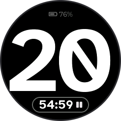

A new game starts at 0.

- **Tap the top half** of the screen to add 1.
- **Tap the bottom half** to subtract 1.
- **Press and hold** the top or bottom half to change by 5. Keep holding and it
  keeps going, 5 at a time.
- The number never goes below 0 or above 99.

**Running change.** When you change the number, a small "+2" or "-3" appears
at the top for about a second and a half. It adds up your quick taps, so you
can see how much you gained or lost in one go. When it goes away, the next tap
starts a new count. (While it shows, it takes the place of the battery icon.)

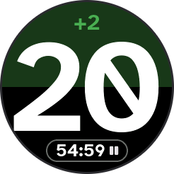

**Tap flash.** Each tap briefly tints the half you touched: green for add, red
for subtract. On a colored background the flash uses your text color instead.

**Underline.** A puck on a table can be read from either side, and some numbers
look like a different number when turned upside down. A 6 looks like a 9. When
that could happen, a short line appears under the number. The line is always
below the number from the player's point of view, so it shows which way is up.
It shows for 6 and 9, and also for numbers such as 66, 68, 86, 89 and 98. It
does not show for numbers that read the same either way up (such as 0, 8, 69
and 88) or for numbers that cannot be mistaken for another one (such as 7 or
25).

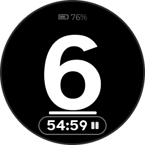

**Timer.** When the timer is on, it sits at the bottom of the screen. See
[The timer](#the-timer).

## Counting with two players

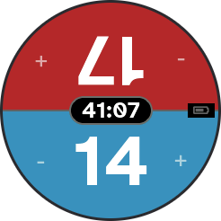

In a two player game the screen is split into two halves, one for each player.

- **Player 1** has the **bottom** half. It reads the normal way up.
- **Player 2** has the **top** half. It is turned upside down, so it reads
  correctly for the person sitting on the opposite side of the table.
- Each half has a small **-** and **+** on its sides. **Left and right are
  from that player's own point of view.** For you at the bottom, tap the left
  side of your half to subtract and the right side to add. Player 2 sits across
  from you, so their left and right are the opposite of yours.
- Tap for 1. Press and hold for 5, and keep holding to keep going.
- Each player has their own number, running change, tap flash and underline.
  Each number stays between 0 and 99.
- The **timer** and the **battery** sit on the line between the two halves.
  When the timer is showing, the battery shows its icon only, even if you
  chose "Icon + %".

Player colors can be set separately for each player. See [Colors](#colors).

## The menu

**Press and hold the center of the screen** to open the menu. (The center is
the middle circle, about the size of a coin.) The menu has four sections, one
in each corner of the screen:

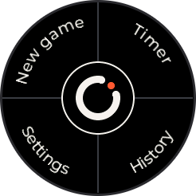

| Section | Where | What it does |
|---|---|---|
| **New game** | top left | Start over. |
| **Timer** | top right | Control the countdown timer. |
| **History** | bottom right | See every change since the game started. |
| **Settings** | bottom left | Colors, brightness and more. |

To pick one, touch it and lift your finger while still inside the same
section. If you slide out of the section before you let go, nothing happens.
**Tap the logo in the center to close the menu.**

### New game

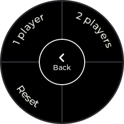

| Choice | Where | What it does |
|---|---|---|
| **1 player** | top left | Start a one player game. |
| **2 players** | top right | Start a two player game. |
| **Reset** | bottom left | Start over with the same number of players. |

Every new game sets all numbers back to 0, clears the history and resets the
timer. The menu closes. In this menu, the center button says **Back** and takes
you to the main menu.

### Timer menu

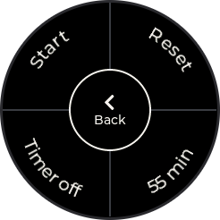

| Choice | Where | What it does |
|---|---|---|
| **Start** / **Pause** | top left | Starts the timer, or pauses it while it runs. |
| **Reset** | top right | Puts the timer back to its full length. |
| **(length) min** | bottom right | Opens the page where you set the length. |
| **Timer off** / **Timer on** | bottom left | Turns the timer off or on. |

If the timer is off, only **Timer on** is shown. Turning the timer off also
resets it. Start, Pause, Reset and the on/off choice close the menu. The
center button says **Back**.

**Setting the length.** Tap the length (for example "55 min"). A page opens
with the number in the middle and a round **-** and **+** button on each side.
Tap a button to change the length by 5 minutes. Hold it to keep going. The
length can be anywhere from 5 to 180 minutes. **Tap the number** (or press the
power button) to go back to the counter. You can also change the length in
[Settings](#timer-length).

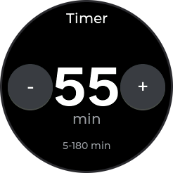

## The power button

The power button does different things depending on how long you press it.

- **Short press:**
  - In a menu, History, Settings, the color screens or the length page: **go
    back** one step. From the main menu it closes the menu.
  - On the counter: **start or pause the timer.** This only works when the
    timer is on.
- **Long press (2 seconds):** turns the puck off.

## The timer

The timer counts **down** from the length you set (55 minutes at first). It is
a small pill-shaped display at the bottom of the screen in a one player game,
and on the line in the middle in a two player game.

- It shows minutes and seconds, such as `54:59`.
- A small **pause** symbol shows next to the time when the timer is not
  running (before you start it, or while it is paused).
- Start and pause it from the menu, or with a short press of the power button.
- When time runs out, it keeps going into **overtime**. It shows a plus sign
  and counts up, such as `+0:42`, in **red**. (In a one player game on a
  colored background, the time stays in your text color so it is easy to read,
  but the plus sign still shows.)
- **Auto-off is held back while the timer runs**, so the puck does not switch
  off in the middle of a game. When you pause the timer, the idle countdown
  starts again.
- If you turn the puck off, the timer comes back **paused** with the time it
  had when it was saved. It does not count while the puck is off.
- If you change the timer length, the remaining time changes with it.
- A new game resets the timer. Turn the timer off in the Timer menu if you do
  not want it on screen.

## History

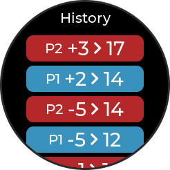

Open it from the menu (bottom right). It lists the changes made since the game
started, **newest first**. Each row shows the change and the new total, such as
"+5 > 25". Scroll with your finger to see older ones. The puck keeps the most
recent 100.

- Quick taps on the same player (each within about a second and a half of the
  last) are **combined** into one row. So five quick taps of +1 show as one
  "+5" row. If they cancel each other out, the row disappears.
- In a two player game, each row starts with **P1** or **P2**.
- Rows use each player's colors. On the default black background, P1 is light
  blue, P2 is amber, adds are green and subtracts are red. On a colored
  background, the row uses that player's own colors.
- With no changes, it says "No changes yet".
- **Tap anywhere** (or tap Done at the bottom of the list) to close it.
  Scrolling does not close it. The power button also closes it.

Starting a new game clears the history.

## Settings

Open Settings from the menu (bottom left). It is a list you scroll with your
finger. Changes apply right away and are saved. Tap **Done** at the bottom (or
press the power button) to go back to the counter.
The firmware version ("OpenPuck v...") is shown at the bottom of Settings, below
**Done**.

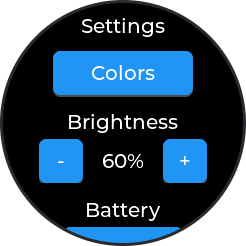

The settings, in order:

### Colors

Pick the colors of your counter. Each player has their own. Tap **P1** or
**P2** at the top to choose whose colors you are changing. P1 is the bottom
player in a two player game, and the color used in a one player game.

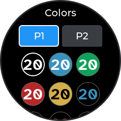

**Presets.** Scroll down to see all nine, in rows of three:

- **Default:** white on black.
- **Blue, Green, Red, Yellow:** a colored background with a white number
  (black on Yellow).
- **Blue text, Green text, Red text, Yellow text:** a black background with a
  colored number.

**Tapping a preset applies it and takes you straight back to the counter.**

**Custom colors.** Below the presets are two buttons: **Custom background**
and **Custom text**.

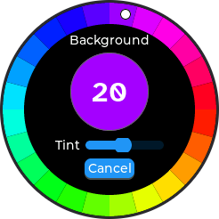

1. Slide your finger around the colored **ring** at the edge to pick the hue
   (the basic color).
2. Use the **Tint** slider in the middle to make it darker or lighter. All the
   way left is black, all the way right is white, and the middle is the pure
   color.
3. The circle in the middle shows a preview. **Tap the circle to save.** Tap
   **Cancel** to leave without saving. The power button also cancels.

When you save a custom background, the puck picks black or white text for you,
whichever is easier to read. You can then change the text color with
**Custom text**.

Tap **Done** to go back to Settings.

### Brightness

Use **-** and **+** to change the screen brightness from 10% to 100%, in steps
of 10%. The default is 60%.

### Battery

Tap the button to switch between three choices:

- **Off:** no battery indicator.
- **Icon:** the battery symbol only. This is the default.
- **Icon + %:** the symbol and the percentage.

In a two player game, the percentage is left out while the timer is showing,
so everything fits on the middle line.

### Timer length

Use **-** and **+** to set the countdown length from 5 to 180 minutes, in
steps of 5. The default is 55.

### Auto-off

A switch. When it is on (the default), the puck turns itself off after it has
been left alone. "Left alone" means no touch and no press of the power button.
Any touch or press starts the countdown over. The puck stays on while the timer
is running.

### Auto-off after

How many minutes the puck waits before it turns itself off. Use **-** and **+**
to pick 1, 2, 5, 10, 15, 20, 30, 45 or 60 minutes. The default is 10. This row
is dimmed when Auto-off is switched off.

## What is saved

The puck remembers these things when it is turned off and back on:

- the numbers, and whether it is a one or two player game,
- the history,
- the timer (it comes back paused),
- all of your settings: colors, brightness, battery display, timer length,
  timer on or off, and auto-off.

Changes are saved a couple of seconds after you stop tapping, and again when
the puck turns itself off. If power is lost right after a tap, that last tap
may not be saved.

## Tips

- Not sure where you are? Tap the power button briefly to go back.
- To change a number fast, press and hold: it adds or subtracts 5 at a time.
- To open the menu, hold the **center**. Holding the top or bottom changes the
  number instead.
- Give the two players different colors so everyone can tell the halves apart
  at a glance.
- A lower brightness is easier on the battery.
- Something not working? See [troubleshooting](troubleshooting.md).
